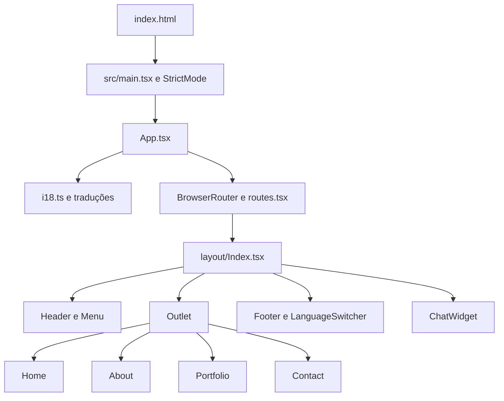
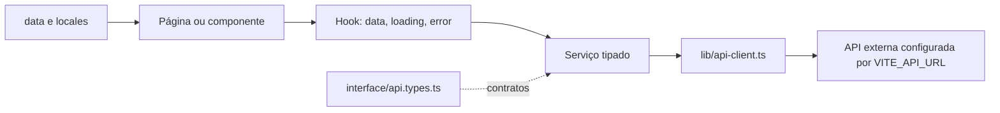

# Análise técnica do projeto Portifólio

Data: 08/10/2026. Origem analisada: `C:\Projeto\portifolio`. Destino solicitado: `C:\Projeto\Hackaton_frontend`.

## 1. Escopo e visão geral

Este documento descreve a implementação local do portfólio: estrutura, inicialização, páginas, componentes, bibliotecas, dados, integrações, estilos, testes e implantação. Também identifica limitações e oportunidades de reutilização como esqueleto de outro frontend. O nome da pasta de destino não foi interpretado como solicitação para migrar ou modificar a aplicação.

A aplicação é uma SPA em React e TypeScript, construída com Vite. Apresenta um portfólio pessoal bilíngue, com quatro páginas, animações, habilidades, projetos e um chat que depende de API externa. Não há implementação de servidor, banco de dados, provedor de IA ou painel administrativo nesta pasta. Referências a .NET, Express, Docker e bancos nas traduções descrevem projetos apresentados no portfólio; não são componentes deste repositório.

Foram inventariados 140 arquivos, sendo 92 em `src`, excluindo `.git`, `node_modules` e `dist`. Há 30 dependências de aplicação e 27 de desenvolvimento. O lockfile usa formato 3. A análise foi baseada nos arquivos locais, sem consulta a versões mais recentes de pacotes ou aos serviços de produção.

O código da aplicação não foi alterado. Os valores de arquivos de ambiente não são reproduzidos. Imagens e PDFs foram inventariados; o conteúdo visual e textual desses binários não foi revisado. A revisão não equivale a teste visual em navegador, auditoria de segurança completa ou validação do backend.

## 2. Estrutura e responsabilidades

```text
portifolio/
├── .github/workflows/deploy.yml   # Build e envio por FTP
├── public/                       # Arquivos públicos, imagens, currículos e rewrites
├── src/
│   ├── assets/
│   │   ├── img/                  # Imagens importáveis pelo frontend
│   │   └── locales/              # Traduções pt.json e en.json
│   ├── components/
│   │   ├── ui/                   # Primitivos locais de interface
│   │   └── .../                  # Componentes específicos do portfólio
│   ├── data/                     # Menus, contatos, serviços e palavras fixas
│   ├── hooks/                    # Estado e chamadas assíncronas
│   ├── interface/                # Contratos TypeScript
│   ├── layout/Index.tsx           # Estrutura compartilhada das páginas
│   ├── lib/                      # Cliente Axios e utilitário de classes
│   ├── pages/                    # home, abaout, portifolio, contact
│   ├── services/                 # Acesso a endpoints HTTP
│   ├── App.tsx                   # Inicialização de i18n e roteamento
│   ├── main.tsx                  # Montagem da aplicação
│   ├── routes.tsx                # Definição das quatro rotas
│   ├── i18.ts                    # Idiomas e detecção
│   └── index.css                 # CSS global e tokens do tema
├── .env.example                  # Nome da variável de configuração da API
├── .env.development              # Configuração do ambiente de desenvolvimento
├── .env.production               # Configuração do ambiente de produção
├── package.json / package-lock.json
├── vite.config.ts
├── tsconfig*.json
├── tailwind.config.js / postcss.config.js
├── components.json               # Configuração shadcn/ui
├── eslint.config.js
├── babel.config.cjs / setup-tests.js
├── index.html
├── vercel.json / web.config
└── README.md
```

O projeto organiza o código por camada técnica. A separação entre componentes, hooks, serviços e DTOs facilita localizar responsabilidades. Não há store global de domínio: os estados usam principalmente `useState`, `useEffect` e `useCallback`. Os componentes de UI possuem contextos locais, como o do carrossel e o de formulário.

Existem inconsistências de nomenclatura: `abaout`, `commom`, `portifolio`, `TooltipMensseg` e `webdeseign`. `Index.tsx` é usado para quase todos os componentes, dificultando distingui-los por nome na busca do editor. Renomear exige atualizar imports e considerar diferenças de maiúsculas e minúsculas no Linux.

## 3. Esqueleto de execução e rotas



`main.tsx` monta `App` em `#root` e importa o CSS global. `App.tsx` importa a inicialização de idiomas e renderiza o roteador. O layout mantém cabeçalho, rodapé e chat enquanto `Outlet` troca a página.

| Rota | Arquivo em src | Conteúdo e origem dos dados |
|---|---|---|
| `/` | `pages/home/Index.tsx` | Apresentação, partículas, texto digitado, redes e contatos fixos |
| `/about` | `pages/abaout/Index.tsx` | Biografia traduzida, foto, dois PDFs, serviços fixos e habilidades da API |
| `/portfolio` | `pages/portifolio/Index.tsx` | Trabalhos e carrossel obtidos da API |
| `/contact` | `pages/contact/Index.tsx` | Informações e redes vindas de arquivos locais |

As páginas são importadas diretamente; não há `React.lazy`/`Suspense` para dividir o carregamento por rota. Não foi encontrada rota curinga de página não encontrada, proteção de rotas ou boundary de erro da aplicação. Como o roteador usa URLs de navegador, o servidor precisa entregar `index.html` ao acessar diretamente uma rota interna.

## 4. Componentes e funcionalidades

| Componente em src/components | Responsabilidade e situação |
|---|---|
| `header` | Logo com link para início e menu |
| `menu` | Navegação sobreposta de tela cheia, animações e estado de abertura |
| `footer` | Idiomas e direitos autorais |
| `language-switcher` | Alterna `pt` e `en` com botões e bandeiras |
| `animate-background` | Motor completo tsParticles, 160 partículas, limite de 120 FPS e interações |
| `custom-button` | Botão ou link, download, tooltip e tradução |
| `custom-carousel` | Projetos da API com Embla e autoplay de dois segundos |
| `custom-progress` | Habilidades da API em barras de progresso |
| `designs` | Cards de trabalhos da API com textos traduzidos por slug |
| `services` | Três serviços a partir de dados locais e traduções |
| `information` | Informações e links de contato fixos |
| `chat-widget` | Chat global, convite inicial, histórico, envio, estados e alternativa por WhatsApp |
| `form-contact` | Formulário implementado, sem integração nas páginas atuais |
| `dialog` | Exemplo de diálogo de confirmação, sem consumidor encontrado |
| `tooltip` | Exemplo de tooltip, sem consumidor encontrado |

### Primitivos de UI

`components/ui` contém nove arquivos: `alert-dialog`, `button`, `carousel`, `form`, `input`, `label`, `progress`, `textarea` e `tooltip`. A configuração `components.json` identifica o estilo `new-york`, base `zinc`, TSX, variáveis CSS e ausência de React Server Components. O código dos componentes está no repositório; não existe dependência de runtime chamada `shadcn` em `package.json`.

Radix fornece alert dialog, label, progress, slot e tooltip. Embla implementa o carrossel, com botões Lucide e navegação por setas. `cn()` combina `clsx` com `tailwind-merge`. `class-variance-authority` define variantes de botão e label.

### Formulário de contato

`ContactForm` usa React Hook Form e Zod. Exige nome com dois caracteres, e-mail válido e mensagem com dez caracteres. Envia `POST` para `http://localhost:5000/send-email` por `fetch`, fora do cliente Axios. Esse endereço é fixo e aponta para a máquina de quem acessa o site. Não há verificação de `response.ok`, e o resultado é exibido por `alert`.

O componente não está montado na página `/contact`. Portanto, o envio de e-mail não é uma funcionalidade ativa demonstrada pelas rotas atuais. Os textos do formulário são fixos em português.

### Chat

`ChatWidget` permanece no layout. O convite inicial aparece após 1,5 segundo, salvo em `localStorage` sob `chatIntroDismissed` quando dispensado. O chat mantém mensagens em memória, posiciona o foco no campo ao abrir e rola até a mensagem mais recente. Enter envia; Shift+Enter permite quebra de linha. Durante uma requisição, bloqueia novo envio pela interface.

`useChat` adiciona a mensagem do usuário, envia o histórico anterior, o texto atual e `language` (`en` ou `pt`) para a API. Acrescenta `answer` como mensagem do assistente e expõe falhas. As respostas são renderizadas como texto React, sem renderização explícita de HTML. O histórico não é persistido entre recarregamentos e não tem limite explícito no frontend. Existe função `clear` no hook, não exposta pelo widget.

Os rótulos de andamento mudam a cada dois segundos por temporizador local; não são eventos reais de progresso do servidor. O widget oferece WhatsApp quando ocorre erro. Não há streaming de respostas no código analisado nem informação que permita confirmar o provedor de IA usado pelo backend.

## 5. Dados, contratos e integração HTTP



O cliente Axios usa `import.meta.env.VITE_API_URL` e `Content-Type: application/json`. Um interceptor adiciona `Authorization: Bearer ...` quando existe `accessToken` no `localStorage`. Não há fluxo de login, renovação de token, logout, timeout explícito ou tratamento centralizado de respostas HTTP nesta implementação.

| Serviço | Método e endpoint | Retorno esperado | Uso atual |
|---|---|---|---|
| habilidades | GET `/api/habilidades` e `/api/habilidades/{id}` | Lista/item `HabilidadeDto` | Lista usada em About |
| projetos-carousel | GET `/api/projetoscarousel` e `/api/projetoscarousel/{id}` | Lista/item `ProjetoCarouselDto` | Lista usada em Portfolio |
| trabalhos | GET `/api/trabalhos` e `/api/trabalhos/{id}` | Lista/item `TrabalhoDto` | Lista usada em Portfolio |
| links-sociais | GET `/api/linkssociais` e `/api/linkssociais/{id}` | Lista/item `LinkSocialDto` | Serviço e hook sem consumidor visual encontrado |
| contato | GET `/api/contato` | `ContatoDto` | Serviço e hook sem consumidor visual encontrado |
| chat | POST `/api/chat` | `ChatResponseDto` | Chat global |

Os métodos `getById` estão definidos, mas não foram encontrados consumidores. Os hooks de leitura executam a consulta na montagem e retornam `data`, `loading`, `error`; não implementam cache compartilhado, cancelamento, retry ou refetch explícito. As listas mostram carregamento e erro, mas não uma mensagem dedicada para resultado vazio.

| Contrato | Campos |
|---|---|
| `HabilidadeDto` | `id`, `label`, `valor`, `ordem` |
| `ProjetoCarouselDto` | `id`, `url`, `imgPath`, `altSlug`, `ordem` |
| `TrabalhoDto` | `id`, `tituloSlug`, `textoSlug`, `imgPath`, `textoBotaoSlug`, `href`, `tooltipSlug`, `ordem` |
| `LinkSocialDto` | `id`, `iconeSlug`, `url`, `tipo`, `ordem` |
| `ContatoDto` | `id`, `nome`, `localizacao`, `telefone`, `email` |
| `ChatMessageDto` | `role`: user/assistant; `content` |
| `ChatRequestDto` | `message`; `language` e `history` opcionais |
| `ChatResponseDto` | `answer` |

`ETipoLinkSocial` define `Social = 1` e `ContatoRapido = 2`. Os campos `ordem` não são usados para ordenar no frontend: a exibição segue a ordem recebida. Os genéricos do Axios descrevem tipos, mas não validam o JSON em runtime; o Zod existente é usado no formulário.

A integração é parcial: projetos e habilidades são remotos, mas redes sociais, contatos e serviços continuam locais. Alterar somente a API de contatos ou de links sociais não mudará a interface atual. `VITE_API_URL` é a única variável identificada nos três arquivos de ambiente; não há proxy configurado em `vite.config.ts`. Sem o backend acessível e seus requisitos de CORS atendidos, as áreas remotas não podem ser validadas apenas pelo frontend.

## 6. Bibliotecas e configuração de desenvolvimento

As versões exatas declaradas e resolvidas estão no inventário ao final. A distribuição de responsabilidades é:

| Grupo | Bibliotecas e função |
|---|---|
| Interface e navegação | React 18, React DOM 18 e React Router DOM 7 |
| Build e linguagem | Vite 6, plugin React, TypeScript 5.6 e tipos de React/Node |
| Estilos | Tailwind CSS 3, PostCSS, Autoprefixer, tailwindcss-animate, clsx, tailwind-merge e CVA |
| UI e ícones | Radix UI, Font Awesome e Lucide |
| HTTP | Axios |
| Idiomas | i18next, react-i18next e detector de idioma do navegador |
| Formulários | React Hook Form, Zod e resolvers |
| Animações | tsParticles, integração React, react-simple-typewriter |
| Carrossel | Embla React e autoplay |
| Qualidade | ESLint 9, typescript-eslint, plugins de hooks e Fast Refresh, globals |
| Testes | Jest 29, jsdom, Testing Library, jest-dom, user-event e identity-obj-proxy |
| Transformação de testes | Babel core, presets env/React/TypeScript e babel-jest |

Font Awesome é usado nas áreas do portfólio; Lucide aparece no carrossel base. Não foi encontrado import de `@fortawesome/free-regular-svg-icons` no código fonte. `@testing-library/user-event` está declarado, mas não é usado no único teste. Bibliotecas de formulário estão associadas principalmente a componentes ainda não integrados às páginas; isso não significa que possam ser removidas sem revisar esses arquivos.

O alias `@/*` aponta para `src/*` no TypeScript, Vite e Jest. O projeto usa módulos ES (`type: module`); a configuração Babel tem extensão `.cjs`. TypeScript tem `strict`, verificação de locais/parâmetros não utilizados e `noEmit`. A configuração da aplicação usa ES2020; a do Vite usa ES2022. O build declarado encadeia `tsc -b` e `vite build`.

| Comando | Finalidade |
|---|---|
| `npm install` | Instalar dependências; pode atualizar o lockfile conforme resolução |
| `npm ci` | Instalação reproduzível a partir do lockfile, adequada ao CI |
| `npm run dev` | Servidor Vite para desenvolvimento |
| `npm run build` | Checagem TypeScript e geração do bundle |
| `npm run preview` | Inspeção local do build já gerado |
| `npm run lint` | Regras ESLint |
| `npm test -- --runInBand` | Testes Jest em uma execução sequencial |

O ambiente observado usa Node 22.15.0 e npm 10.9.2. O README cita Node 20.12.1, e o manifesto não define `engines` nem foi localizado `.nvmrc`. Convém registrar uma versão validada e usá-la também no CI. Este relatório não pressupõe que a atualização de npm sugerida pelo terminal seja necessária.

## 7. Idiomas, estilos, recursos e acessibilidade

### Internacionalização

Há 84 chaves em português e 84 em inglês, sem diferença entre os conjuntos de chaves. A igualdade de chaves não garante que todos os textos estejam traduzidos: slugs vindos da API dependem do backend, alguns valores são literais e parte das palavras do Typewriter usa a própria chave como texto.

O idioma de fallback é inglês. A ordem de detecção começa por `navigator`, antes de `localStorage` e cookie, embora a escolha seja armazenada nesses locais. Isso pode fazer a preferência do navegador prevalecer sobre a escolha salva ao recarregar. O atributo HTML permanece `lang="en"`; não há sincronização com a troca de idioma. Formulário, exemplos e textos acessíveis do carrossel também possuem literais.

### Identidade visual e CSS

Predominam preto, cinza e amarelo, com Montserrat e Black Ops One carregadas pelo Google Fonts. A interface usa utilitários Tailwind e breakpoints, especialmente `lg`. O CSS define tokens de tema claro/escuro, mas não foi encontrado controle de tema. O layout aplica fundo preto diretamente. `App.css` está vazio.

Há regras globais de `p`, `button`, `label` e títulos com `!important`. Elas podem sobrepor classes de tamanho nos componentes, inclusive no chat. A folha também define scrollbars e animações de menu. O HTML carrega Montserrat em duas URLs de fontes e indica MIME SVG para um favicon PNG.

### Recursos estáticos e custo de carregamento

Há 20 pares de imagens idênticas entre `src/assets` e `public`, confirmados por SHA-256. São 11 imagens do carrossel, seis do portfólio e três logos. A imagem `carousel-img-7.png` tem 2.344.005 bytes por cópia. A duplicação aumenta o repositório; seu impacto no bundle depende dos imports e do conteúdo copiado de `public`, portanto não foi quantificado como duplicação de tráfego.

Não há `loading="lazy"` nos cards de projetos analisados. O uso de `loadFull`, 160 partículas e 120 FPS é um ponto a medir em aparelhos modestos. Não foi localizada adaptação explícita a movimento reduzido. Existem dois currículos em PDF, uma imagem padrão do Vite e um arquivo de verificação Google.

### Acessibilidade e metadados

O menu usa `div` clicável para abrir e fechar, sem a semântica e os controles de teclado de um botão. Não há gerenciamento explícito de foco, Escape ou isolamento do conteúdo atrás do menu. O menu fechado é deslocado por transform; seus links não são explicitamente removidos da navegação por teclado.

Links sociais com apenas ícone precisam de nomes acessíveis. Na Home, o mesmo `aria-label` de Telegram é aplicado também ao WhatsApp. O chat tem nomes em botões e foco inicial, mas não define região viva de mensagens nem semântica de diálogo. O textarea usa placeholder sem label explícito.

Em `ui/progress.tsx`, `value` é retirado das props e usado no visual, mas não é repassado ao `ProgressPrimitive.Root`; a informação acessível de progresso precisa ser revisada. No carrossel, o cleanup remove o listener `select`, mas não o `reInit` registrado no mesmo efeito.

O HTML contém título estático, mas não possui meta description ou Open Graph. Não foram localizados sitemap, robots.txt, títulos por rota ou `h1` nas páginas revisadas. Esses são achados de código; contraste, navegação assistiva e layout precisam de testes no navegador.

## 8. Implantação e configuração operacional

O workflow `Deploy via FTP` dispara em push para `main`, executa em `ubuntu-latest`, faz checkout, roda `npm install` e `npm run build`, e envia `dist/` para `/public_html/` com `SamKirkland/FTP-Deploy-Action@v4.0.0`. Usa os nomes de secrets `FTP_SERVER`, `FTP_USERNAME` e `FTP_PASSWORD`; nenhum valor foi acessado.

Não há etapa `setup-node`, fixação explícita da versão do Node, cache npm, lint ou teste antes do deploy. Recomenda-se tornar o ambiente reproduzível e incluir as verificações relevantes antes de publicar.

Há configuração de fallback de SPA para três destinos: Apache (`public/.htaccess`), IIS (`web.config`, também em `public`) e Vercel (`vercel.json`, também em `public`). As cópias podem divergir com manutenção. O arquivo IIS exclui caminhos `/api` do rewrite; a regra Apache não tem essa exceção. Se a API compartilhar a mesma origem, é necessário revisar como cada servidor encaminha esses caminhos. A presença dessas configurações não comprova hospedagem ativa em todos os destinos.

O `.gitignore` ignora `node_modules`, `dist`, logs e `*.local`, mas não estabelece uma regra geral para `.env`. Não foi feita auditoria do histórico Git. A variável identificada é uma URL de API; não se presume que exista segredo nela. Valores destinados ao frontend devem ser tratados como públicos, e eventuais segredos de servidor devem permanecer fora do bundle.

## 9. Verificações executadas

As ferramentas instaladas no projeto foram chamadas diretamente para inspecionar o estado atual, sem reinstalar dependências.

| Verificação | Comando/critério | Resultado |
|---|---|---|
| TypeScript da aplicação | `node node_modules/typescript/bin/tsc -p tsconfig.app.json --noEmit --incremental false` | Sem diagnósticos |
| TypeScript da configuração | Mesmo comando com `tsconfig.node.json` | Sem diagnósticos |
| Lint | `node node_modules/eslint/bin/eslint.js .` | Falhou: 2 erros e 2 avisos |
| Testes | `node node_modules/jest/bin/jest.js --runInBand --no-cache` | 1 suíte, 1 teste aprovado |
| Traduções | Parse JSON e comparação de chaves com Node | 84 chaves por idioma, conjuntos iguais |
| Duplicação de imagens | SHA-256 | 20 pares de arquivos idênticos |

Erros de lint: `animate-background/Index.tsx:19` usa `any`; `form-contact/Index.tsx:38` declara `error` sem uso. Avisos: `ui/button.tsx:57` e `ui/form.tsx:168` misturam exportações de componentes e outros elementos, sinalizados pela regra de Fast Refresh.

O único teste é `pages/home/__tests__/Home.spec.tsx`. Renderiza Home e executa `expect(1).toBe(1)`. Assim, comprova apenas que esse cenário de renderização não lançou erro; não valida conteúdo, navegação, tradução, interação ou API. A execução emitiu aviso de i18next não inicializado no teste e de base Browserslist antiga.

O build Vite completo, a aplicação em navegador, os endpoints, o envio de contato, as respostas de IA, a acessibilidade e a implantação não foram executados/validados. A checagem TypeScript aprovada não é apresentada como build de produção aprovado.

O log de `npm install` inspecionado anteriormente nesta sessão terminou com `exit 0` e `info ok`; continha depreciações e relatório de auditoria. Não foi realizada nova auditoria online nem atribuída contagem atual de vulnerabilidades. A atualização de dependências deve ser uma tarefa própria, com avaliação de impacto e testes.

## 10. Achados e prioridades

| Prioridade | Achado comprovado | Impacto e encaminhamento |
|---|---|---|
| Alta | Lint com dois erros | Corrigir tipos e variável não utilizada antes de torná-lo obrigatório no CI |
| Alta | Único teste sem assertiva de comportamento | Cobrir navegação, idiomas e estados de sucesso/erro das integrações |
| Alta | Contatos e redes mantidos em mais de uma fonte | Definir API ou dados locais como fonte oficial e concluir/remover integrações pendentes |
| Alta, se ativado | Formulário aponta para localhost e não verifica status HTTP | Integrar ao cliente configurado, tratar respostas e só então montar na página |
| Média | API sem timeout/cancelamento/validação de resposta | Definir limites, estados vazios, contrato validado e recuperação de falhas |
| Média | Menu e ícones com lacunas de acessibilidade | Adotar botões, nomes acessíveis, foco e operação por teclado |
| Média | Escolha de idioma pode ser sobreposta pela detecção | Priorizar escolha persistida e atualizar o `lang` do documento |
| Média | CSS global com `!important` e tamanhos genéricos | Restringir estilos e verificar chat, formulários e textos pequenos |
| Média | CI sem Node fixado ou etapas de qualidade | Fixar runtime validado, usar lockfile e rodar checks antes de publicar |
| Média | Pacotes com avisos no log de instalação | Avaliar `npm audit` atualizado e corrigir por impacto; não aplicar atualização major indiscriminada |
| Média | Partículas completas, imagens grandes e cópias | Medir bundle e desempenho, otimizar imagens e consolidar caminhos |
| Baixa | README diverge da implementação | Atualizar API, chat, pré-requisitos e estilos reais |
| Baixa | Exemplos sem uso e nomes inconsistentes | Remover ou documentar exemplos, padronizar nomes com atualização dos imports |

Outros pontos: adicionar página não encontrada; revisar semântica do progresso; remover ambos os listeners do carrossel; limitar histórico e comprimento de mensagens conforme contrato do chat; centralizar o número de WhatsApp; revisar metadados e carregamento por rota. Não foram feitas correções neste trabalho de documentação.

O README menciona `cssnano`, mas o pacote e a configuração citados não estão presentes. Descreve habilidades e carrossel como dados de arquivos locais, enquanto o código atual consulta API. Também não cobre a integração atual do chat. O código foi considerado fonte principal desta análise.

## 11. Reutilização como base para Hackaton_frontend

O esqueleto reutilizável é a combinação de Vite, React, TypeScript, alias `@`, layout com Outlet, componentes locais de UI, cliente HTTP, serviços tipados e hooks. O portfólio não é ainda um template genérico: identidade pessoal, textos, PDFs, imagens, URLs e contatos estão distribuídos pelo projeto.

Uma evolução possível, sem necessidade de introduzir outra biblioteca de estado neste momento:

```text
src/
├── app/                  # App, rotas e inicializações compartilhadas
├── layouts/              # Estruturas das telas
├── pages/                # Composição das páginas
├── features/             # Domínios: componentes, hooks, serviços e tipos juntos
├── components/ui/        # Primitivos reutilizáveis
├── lib/                  # HTTP e utilitários
├── config/               # Configuração pública e validação de ambiente
├── locales/              # Traduções
└── assets/               # Recursos importados
```

Essa árvore é uma proposta, não a estrutura atual nem uma migração executada. Antes de reutilizar: definir o domínio da hackathon, substituir identidade e conteúdo, escolher as rotas necessárias, confirmar o contrato de API, integrar somente as funcionalidades usadas, corrigir os checks e validar build/navegação. Partículas, carrossel, chat, formulários e idiomas devem ser mantidos conforme o produto realmente precisar.

## 12. Roteiro de manutenção e fontes locais

Para adicionar uma página: criar o componente em `pages`, registrar a rota em `routes.tsx`, adicionar o item em `data/menu/menu.data.tsx` se necessário e incluir suas traduções. Para um recurso remoto: definir o DTO, implementar serviço usando `api`, criar o hook e tratar carregamento, erro, vazio e sucesso na UI. Para uma imagem: decidir entre import em `src/assets` ou caminho público estável e evitar manter ambas as cópias sem motivo.

As evidências principais são `package.json`, `package-lock.json`, `src/main.tsx`, `src/routes.tsx`, `src/layout/Index.tsx`, todos os componentes/páginas/hooks/serviços locais, `src/interface/api.types.ts`, `src/lib/api-client.ts`, `src/i18.ts`, os dois arquivos de tradução, configurações da raiz e `.github/workflows/deploy.yml`. As tabelas seguintes preservam o inventário de dependências e arquivos para consulta independente deste resumo.


## 13. Inventário completo de dependências diretas

Versões declaradas extraídas de `package.json`; versões resolvidas extraídas de `package-lock.json`. Não representam uma consulta às versões mais recentes do registro npm.

### Dependências de aplicação

| Pacote | Declarada | Resolvida no lockfile |
|---|---|---|
| `@fortawesome/fontawesome-svg-core` | `^6.7.1` | `6.7.1` |
| `@fortawesome/free-brands-svg-icons` | `^6.7.1` | `6.7.1` |
| `@fortawesome/free-regular-svg-icons` | `^6.7.1` | `6.7.1` |
| `@fortawesome/free-solid-svg-icons` | `^6.7.1` | `6.7.1` |
| `@fortawesome/react-fontawesome` | `^0.2.2` | `0.2.2` |
| `@hookform/resolvers` | `^3.10.0` | `3.10.0` |
| `@radix-ui/react-alert-dialog` | `^1.1.3` | `1.1.3` |
| `@radix-ui/react-label` | `^2.1.1` | `2.1.1` |
| `@radix-ui/react-progress` | `^1.1.1` | `1.1.1` |
| `@radix-ui/react-slot` | `^1.1.1` | `1.1.1` |
| `@radix-ui/react-tooltip` | `^1.1.6` | `1.1.6` |
| `@tsparticles/react` | `^3.0.0` | `3.0.0` |
| `axios` | `^1.15.2` | `1.15.2` |
| `class-variance-authority` | `^0.7.1` | `0.7.1` |
| `clsx` | `^2.1.1` | `2.1.1` |
| `embla-carousel-autoplay` | `^8.5.2` | `8.5.2` |
| `embla-carousel-react` | `^8.5.2` | `8.5.2` |
| `i18next` | `^24.0.5` | `24.0.5` |
| `i18next-browser-languagedetector` | `^8.0.0` | `8.0.0` |
| `lucide-react` | `^0.468.0` | `0.468.0` |
| `react` | `^18.3.1` | `18.3.1` |
| `react-dom` | `^18.3.1` | `18.3.1` |
| `react-hook-form` | `^7.54.2` | `7.54.2` |
| `react-i18next` | `^15.1.3` | `15.1.3` |
| `react-router-dom` | `^7.0.2` | `7.0.2` |
| `react-simple-typewriter` | `^5.0.1` | `5.0.1` |
| `tailwind-merge` | `^2.5.5` | `2.5.5` |
| `tailwindcss-animate` | `^1.0.7` | `1.0.7` |
| `tsparticles` | `^3.7.1` | `3.7.1` |
| `zod` | `^3.24.1` | `3.24.1` |

### Dependências de desenvolvimento

| Pacote | Declarada | Resolvida no lockfile |
|---|---|---|
| `@babel/core` | `^7.26.7` | `7.26.7` |
| `@babel/preset-env` | `^7.26.7` | `7.26.7` |
| `@babel/preset-react` | `^7.26.3` | `7.26.3` |
| `@babel/preset-typescript` | `^7.26.0` | `7.26.0` |
| `@eslint/js` | `^9.15.0` | `9.16.0` |
| `@testing-library/jest-dom` | `^6.6.3` | `6.6.3` |
| `@testing-library/react` | `^16.2.0` | `16.2.0` |
| `@testing-library/user-event` | `^14.6.1` | `14.6.1` |
| `@types/jest` | `^29.5.14` | `29.5.14` |
| `@types/node` | `^22.10.2` | `22.10.2` |
| `@types/react` | `^18.3.12` | `18.3.12` |
| `@types/react-dom` | `^18.3.1` | `18.3.1` |
| `@vitejs/plugin-react` | `^4.3.4` | `4.3.4` |
| `autoprefixer` | `^10.4.20` | `10.4.20` |
| `babel-jest` | `^29.7.0` | `29.7.0` |
| `eslint` | `^9.15.0` | `9.16.0` |
| `eslint-plugin-react-hooks` | `^5.0.0` | `5.0.0` |
| `eslint-plugin-react-refresh` | `^0.4.14` | `0.4.16` |
| `globals` | `^15.12.0` | `15.13.0` |
| `identity-obj-proxy` | `^3.0.0` | `3.0.0` |
| `jest` | `^29.7.0` | `29.7.0` |
| `jest-environment-jsdom` | `^29.7.0` | `29.7.0` |
| `postcss` | `^8.4.49` | `8.4.49` |
| `tailwindcss` | `^3.4.15` | `3.4.15` |
| `typescript` | `~5.6.2` | `5.6.3` |
| `typescript-eslint` | `^8.15.0` | `8.17.0` |
| `vite` | `^6.0.1` | `6.0.2` |

## 14. Inventário de arquivos do projeto

Exclui `.git`, `node_modules` e `dist`. Arquivos de ambiente são listados apenas pelo nome; seus valores não são reproduzidos. Os binários foram inventariados e comparados por hash, sem revisão visual das imagens ou leitura do conteúdo dos PDFs.

```text
.env.development
.env.example
.env.production
.github/workflows/deploy.yml
.gitignore
README.md
babel.config.cjs
components.json
eslint.config.js
index.html
package-lock.json
package.json
postcss.config.js
public/.htaccess
public/assets/img/carousel/carousel-img-1.png
public/assets/img/carousel/carousel-img-10.png
public/assets/img/carousel/carousel-img-11.png
public/assets/img/carousel/carousel-img-2.png
public/assets/img/carousel/carousel-img-3.png
public/assets/img/carousel/carousel-img-4.png
public/assets/img/carousel/carousel-img-5.png
public/assets/img/carousel/carousel-img-6.png
public/assets/img/carousel/carousel-img-7.png
public/assets/img/carousel/carousel-img-8.png
public/assets/img/carousel/carousel-img-9.png
public/assets/img/portfolio/portfolio-fifth.png
public/assets/img/portfolio/portfolio-first.jpg
public/assets/img/portfolio/portfolio-fourth.jpg
public/assets/img/portfolio/portfolio-second.jpg
public/assets/img/portfolio/portfolio-sixth.png
public/assets/img/portfolio/portfolio-third.jpg
public/googled9dce84159f2fe5a.html
public/logo-bg.png
public/logo-information.png
public/logo.png
public/thiago-souza-CV.pdf
public/thiago-souza-us-CV.pdf
public/vercel.json
public/vite.svg
public/web.config
setup-tests.js
src/App.css
src/App.tsx
src/assets/img/carousel/carousel-img-1.png
src/assets/img/carousel/carousel-img-10.png
src/assets/img/carousel/carousel-img-11.png
src/assets/img/carousel/carousel-img-2.png
src/assets/img/carousel/carousel-img-3.png
src/assets/img/carousel/carousel-img-4.png
src/assets/img/carousel/carousel-img-5.png
src/assets/img/carousel/carousel-img-6.png
src/assets/img/carousel/carousel-img-7.png
src/assets/img/carousel/carousel-img-8.png
src/assets/img/carousel/carousel-img-9.png
src/assets/img/commom/Captura de tela 2025-03-24 195049.png
src/assets/img/commom/bandeira-brasil.webp
src/assets/img/commom/bandeira-estados-unidos.webp
src/assets/img/commom/img-contact-1.jpg
src/assets/img/commom/img-contact-2.jpg
src/assets/img/commom/img-contact-3.jpg
src/assets/img/commom/img-contact-4.jpg
src/assets/img/commom/img-contact-5.jpg
src/assets/img/commom/img-im-1.jpeg
src/assets/img/commom/img-im-2.jpeg
src/assets/img/commom/img-im-3.jpeg
src/assets/img/logos/logo-bg.png
src/assets/img/logos/logo-information.png
src/assets/img/logos/logo.png
src/assets/img/portfolio/portfolio-fifth.png
src/assets/img/portfolio/portfolio-first.jpg
src/assets/img/portfolio/portfolio-fourth.jpg
src/assets/img/portfolio/portfolio-second.jpg
src/assets/img/portfolio/portfolio-sixth.png
src/assets/img/portfolio/portfolio-third.jpg
src/assets/locales/en.json
src/assets/locales/pt.json
src/components/animate-background/Index.tsx
src/components/chat-widget/Index.tsx
src/components/custom-button/Index.tsx
src/components/custom-carousel/Index.tsx
src/components/custom-progress/Index.tsx
src/components/designs/Index.tsx
src/components/dialog/Index.tsx
src/components/footer/Index.tsx
src/components/form-contact/Index.tsx
src/components/header/Index.tsx
src/components/information/Index.tsx
src/components/language-switcher/Index.tsx
src/components/menu/Index.tsx
src/components/services/Index.tsx
src/components/tooltip/Index.tsx
src/components/ui/alert-dialog.tsx
src/components/ui/button.tsx
src/components/ui/carousel.tsx
src/components/ui/form.tsx
src/components/ui/input.tsx
src/components/ui/label.tsx
src/components/ui/progress.tsx
src/components/ui/textarea.tsx
src/components/ui/tooltip.tsx
src/data/information/information.data.ts
src/data/menu/menu.data.tsx
src/data/service-data/service.data.ts
src/data/social/social.data.ts
src/data/typewriter/words.ts
src/hooks/useChat.ts
src/hooks/useContato.ts
src/hooks/useHabilidades.ts
src/hooks/useLinksSociais.ts
src/hooks/useProjetosCarousel.ts
src/hooks/useTrabalhos.ts
src/i18.ts
src/index.css
src/interface/api.types.ts
src/interface/custom-button-props.interface.ts
src/interface/menu.interface.ts
src/layout/Index.tsx
src/lib/api-client.ts
src/lib/utils.ts
src/main.tsx
src/pages/abaout/Index.tsx
src/pages/contact/Index.tsx
src/pages/home/Index.tsx
src/pages/home/__tests__/Home.spec.tsx
src/pages/portifolio/Index.tsx
src/routes.tsx
src/services/chat.service.ts
src/services/contato.service.ts
src/services/habilidades.service.ts
src/services/links-sociais.service.ts
src/services/projetos-carousel.service.ts
src/services/trabalhos.service.ts
src/vite-env.d.ts
tailwind.config.js
tsconfig.app.json
tsconfig.json
tsconfig.node.json
vercel.json
vite.config.ts
web.config
```

## 15. Recursos binários duplicados

Grupos com conteúdo idêntico confirmado por SHA-256:

- `public/assets/img/carousel/carousel-img-1.png` = `src/assets/img/carousel/carousel-img-1.png`.
- `public/assets/img/carousel/carousel-img-10.png` = `src/assets/img/carousel/carousel-img-10.png`.
- `public/assets/img/carousel/carousel-img-11.png` = `src/assets/img/carousel/carousel-img-11.png`.
- `public/assets/img/carousel/carousel-img-2.png` = `src/assets/img/carousel/carousel-img-2.png`.
- `public/assets/img/carousel/carousel-img-3.png` = `src/assets/img/carousel/carousel-img-3.png`.
- `public/assets/img/carousel/carousel-img-4.png` = `src/assets/img/carousel/carousel-img-4.png`.
- `public/assets/img/carousel/carousel-img-5.png` = `src/assets/img/carousel/carousel-img-5.png`.
- `public/assets/img/carousel/carousel-img-6.png` = `src/assets/img/carousel/carousel-img-6.png`.
- `public/assets/img/carousel/carousel-img-7.png` = `src/assets/img/carousel/carousel-img-7.png`.
- `public/assets/img/carousel/carousel-img-8.png` = `src/assets/img/carousel/carousel-img-8.png`.
- `public/assets/img/carousel/carousel-img-9.png` = `src/assets/img/carousel/carousel-img-9.png`.
- `public/assets/img/portfolio/portfolio-fifth.png` = `src/assets/img/portfolio/portfolio-fifth.png`.
- `public/assets/img/portfolio/portfolio-first.jpg` = `src/assets/img/portfolio/portfolio-first.jpg`.
- `public/assets/img/portfolio/portfolio-fourth.jpg` = `src/assets/img/portfolio/portfolio-fourth.jpg`.
- `public/assets/img/portfolio/portfolio-second.jpg` = `src/assets/img/portfolio/portfolio-second.jpg`.
- `public/assets/img/portfolio/portfolio-sixth.png` = `src/assets/img/portfolio/portfolio-sixth.png`.
- `public/assets/img/portfolio/portfolio-third.jpg` = `src/assets/img/portfolio/portfolio-third.jpg`.
- `public/logo-bg.png` = `src/assets/img/logos/logo-bg.png`.
- `public/logo-information.png` = `src/assets/img/logos/logo-information.png`.
- `public/logo.png` = `src/assets/img/logos/logo.png`.
